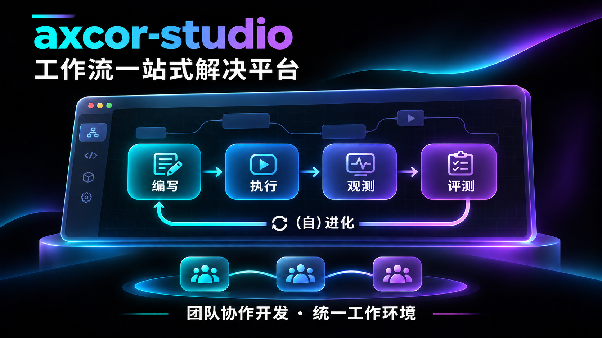

# Axcor Studio

Axcor Studio 是用于编写、运行和观察工作流的桌面工作台。你可以打开本地、SSH 远程目录或远程 Docker 容器中的目录，编辑 Graph YAML，启动工作流或单次 Agent 会话，并查看运行结果。

## 快速开始

### 安装桌面应用

发布包面向搭载 Apple 芯片的 Mac（macOS arm64）。版本发布后，从 [Releases](https://github.com/guixu-labs/axcor-studio/releases) 下载 ZIP，解压并打开 `axcor-studio.app`。

### 准备环境

在本地运行时，需要在桌面应用所在的机器上安装以下服务。使用远程工作区时，在服务器上准备运行环境，详见[远程工作区](#远程工作区)。

- **Workflow Controller** 用于执行 Graph 和 Agent 会话。目前通过源码安装，见 [Workflow Controller 安装说明](https://gitcode.com/qwren/opsbot/blob/main/README.md)。
- **Context Insight** 用于查看会话轨迹。运行 `npm install -g context-insight` 安装。详见 [Context Insight npm 包](https://www.npmjs.com/package/context-insight)。

### 运行第一个 Agent 会话

1. 在启动页点击「打开本地工作区」，选择一个本地目录。在「设置 → 模型供应商」配置一个可用模型。
2. 打开「运行 → 运行配置」，选择「Workflow Controller Session」，选定 Agent 运行时和模型。
3. 输入提示词「只回复 OK」，点击「运行工作流」。在运行列表中打开刚创建的记录，查看状态和事件日志。如果运行详情中出现「在 Insight 中查看」，可点击回看会话轨迹。

会话的「高级设置」可以配置系统提示词、评估器、最大迭代，以及 Reviewer 的启用状态、模型、目标、思考模式和 token 预算。Reviewer 模型和思考模式来自当前服务端的供应商验证结果。选择「启用」思考模式后可设置 token 预算。留空的参数由服务端按项目配置解析。

使用 Claude CLI、OpenCode 或 Codex CLI 时，可以在「通过 cpx 捕获」中选择启用、关闭或沿用项目配置。启用前需在运行 Workflow Controller 的环境（本机、远端主机或容器）中安装 `cpx`，并确保服务进程能从 `PATH` 找到它。

模型供应商测试最多等待 30 秒，结果显示在操作按钮旁。错误消息较长时，将鼠标停在提示上可查看完整内容。

## 远程工作区

### 连接服务器

1. 运行环境：在服务器上使用对应用户安装 Python 3.8+、Workflow Controller、Context Insight，以及运行所需的Agent框架，为 Controller 和 Insight 分别选定端口。注意，在共享服务器上，为每位用户分配独立端口，避免连接到其他用户的服务。目前只支持从服务器的 `127.0.0.1` 访问。
2. 首次连接前，在终端核验服务器主机密钥，确认可用密钥或密码登录，并确认 SSH 服务端允许本地端口转发。桌面应用使用本机的 `known_hosts` 和 SSH 配置，包括跳板机设置，并默认使用 SSH 配置或密钥认证。
3. 在启动页选择「打开远程工作区」，从本机 `~/.ssh/config` 选择主机，或手动输入 `user@hostname` 和可选的 SSH 端口。手动添加的主机可通过「保存到 SSH 配置」并设置别名。填写服务器上的工作区绝对路径，以及 Controller 和 Insight 的远端端口，然后连接。
4. 连接后，在「设置 → 模型供应商」为远端 Workflow Controller 配置所需的模型、API 密钥和端点。

连接时，应用会通过 SSH 自动安装随应用分发的文件助手，并在升级后的首次连接中使用新版助手。文件助手会复用健康服务，或以 SSH 用户身份在服务器后台启动缺失的服务。关闭桌面应用会关闭 SSH 转发，非应用启动的远端服务可供下次连接复用。

### 使用 SSH 密码

在 macOS 和 Linux 上，可将「认证方式」切换为「密码」，然后输入宿主机的 SSH 密码。Docker 模式也使用这个密码来查询容器和建立转发。密码仅在当前应用会话中用于连接和重连，重新打开应用时需要再次输入。首次连接前仍需核验并记录服务器的主机密钥。此模式使用 SSH 的密码认证，跳板机请配置可用的密钥。

### 连接 Docker 容器

在「打开远程工作区」中将连接类型切换为「Docker 容器」。填写 SSH 宿主机后，点击「加载容器」并选择运行中的 Linux 容器，再填写容器内的工作区绝对路径和两个服务端口。

SSH 用户需要能在宿主机上执行 Docker 命令。容器内需要 Python 3.8+、Workflow Controller、Context Insight 和所需的 Agent 框架，容器的默认用户需要有权访问工作区。应用会在容器内自动部署文件助手，并复用或分别启动两个服务。两个服务可继续监听容器内的 `127.0.0.1`，无需发布 Docker 端口或在容器内配置 SSH。

如果容器被删除或替换，重新打开「打开远程工作区」并选择新的容器。排查服务启动失败时，在容器内查看服务日志。

### 编辑和运行

- 文件树支持打开和保存 UTF-8 文本文件，每个文件最多 2 MiB。展开文件夹时会加载其直接子项。文件树和没有未保存改动的文件会随服务器上的变更自动更新，也可点击「同步」手动检查。
- Graph 的「运行文件」填写工作区内的相对路径，留空时运行当前文件。Agent 会话使用远端工作区作为项目目录。

### 处理连接和保存问题

- **SSH 断线**。点击「重新连接」。运行列表和文件刷新结束后，状态栏会显示已连接。未保存的草稿保留在当前窗口。如果断线时无法确定运行是否已提交，先查看刷新后的运行列表，再决定是否重试。
- **保存冲突**。应用会保留草稿。先复制草稿，再关闭文件并选择放弃修改，重新打开文件即可查看服务器版本。
- **服务启动失败**。先看启动页的服务名称和错误详情，再按[日志排查指南](doc/axcor-studio-log-troubleshooting.md)定位日志。可在启动页重试失败的服务，或点击右上角「×」退出应用。

## 日志排查

遇到本地或远程启动失败、连接超时或运行异常时，参见[日志排查指南](doc/axcor-studio-log-troubleshooting.md)。

## 后续规划

计划支持评测和工作流（自）进化，见[方案设计](doc/axcor-studio-design.md)。

## 技术栈

| 用途           | 技术                                        |
| -------------- | ------------------------------------------- |
| 桌面应用       | Electron、Node.js、TypeScript               |
| 用户界面       | React、CSS                                  |
| 文件编辑       | Monaco Editor                               |
| 服务集成       | Electron IPC、HTTP API、WebContentsView     |
| 构建与分发     | Vite、Electron Forge、npm                   |
| 测试与代码检查 | Node.js 测试运行器、tsx、Playwright、ESLint |

## 许可证

[MIT](LICENSE)
