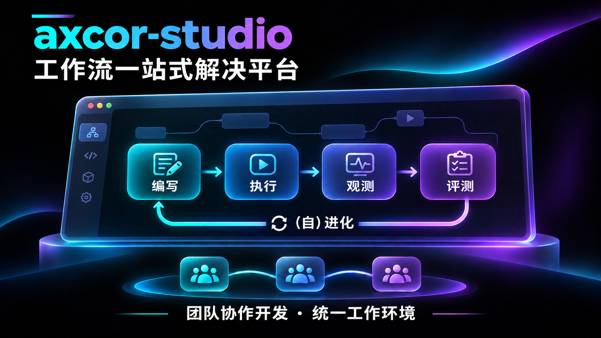

# axcor-studio



axcor-studio 定位为**工作流一站式解决平台**，目标是贯通工作流的编写、执行、观测、评测、（自）进化，支持团队间协作开发，为用户提供统一的工作环境。

当前以 Electron Forge + Vite + React 构建桌面工作台，接入 Workflow Controller 提供工作流执行服务，并嵌入 Insight 观测视图。下文说明当前已实现的能力与开发方式。

## 开发启动

```bash
npm install
npm run start
```

桌面应用通过 Electron IPC 访问 Workflow Controller API，支持选择工作区、使用 Monaco 编辑并保存 Markdown、查看和控制运行、轮询运行事件，以及在内嵌 Insight 视图中打开已导入的会话。

默认地址为 `http://127.0.0.1:18600`。工作台启动时会复用可访问的服务，本地服务不可用时会尝试执行 `workflow-controller web --port 18600 --no-open`。可通过「设置 → 常规」修改连接地址，或在启动工作台时通过 `EXECUTION_BACKEND_BASE_URL` 配置地址。设定 `EXECUTION_BACKEND_NO_AUTOSTART=1` 可关闭自动启动。

执行后端的显示名称和 CLI 命令集中定义在 `src/shared/executionBackendConfig.ts`。

打开「观测」或导入运行会话时，工作台会连接本机的 Context Insight（默认 `http://127.0.0.1:21025`）。如果服务未运行，工作台会通过 PATH 中的 `context-insight` 命令启动服务，并在退出时停止自己启动的实例。首次启动可能需要构建 Insight 页面。

可在启动工作台时通过 `CONTEXT_INSIGHT_PORT` 指定端口，或设置 `CONTEXT_INSIGHT_NO_AUTOSTART=1` 使用手动启动的实例。会话导入仍由 Workflow Controller 定位转录文件。如果 Workflow Controller 是单独启动的，请在启动它时将 `WORKFLOW_CONTROLLER_INSIGHT_PORT` 设为同一个端口。

`MockExecutionClient` 保留用于隔离测试。产物获取和 Evidence 面板仍为占位实现；运行完成本身不代表代码或业务验收通过。

依赖配置将 `@electron/rebuild` 固定为已发布的 4.2.0 版本，避免旧版本引入托管在 GitHub 上的 `@electron/node-gyp` 源码依赖，降低受限网络环境下的安装失败风险。

## 检查与验证

```bash
npm run lint
npm run test
npm run test:e2e
npm run package
npm run make
```

按改动范围选择检查。HTTP 和 Electron E2E 测试使用本地 fixture，真实 Workflow Controller 和 Insight 服务的验证结果需单独记录。构建或分发相关改动需要执行打包检查。
