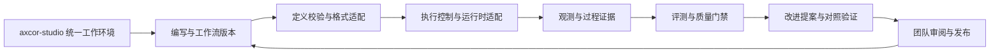

# axcor-studio 方案设计

## 1. 产品定位与范围

axcor-studio 定位为**工作流一站式解决平台**，目标是贯通工作流的编写、执行、观测、评测、（自）进化，支持团队间协作开发，为用户提供统一的工作环境。

工作流及其版本是可共同开发的资产。每次运行关联确定的工作流版本、执行环境、过程证据和评测结果。改进从这些记录出发，经验证和审阅后形成下一版本，其他团队可按权限发现、采用和维护已发布的版本。

| 环节 | 用户在平台上完成的工作 |
| --- | --- |
| 编写 | 创建工作流，定义输入、阶段、角色、工具和验收条件，管理工作流及依赖资产版本。 |
| 执行 | 核对计划和权限，选择运行环境，发起任务并按需接管。 |
| 观测 | 查看运行、步骤和工具调用，把失败或产物追溯到对应步骤。 |
| 评测 | 根据验收条件评估结果与过程，比较基线并记录门禁结论。 |
| （自）进化 | 从运行证据和评测差异提出改进，通过对照验证后发布新版本。 |
| 团队间协作 | 共享版本、交接运行和证据，审阅改进并按权限发布或采用。 |

当前交付形态是 Electron 桌面工作台，已接通 Markdown 编辑与保存、Opsbot 运行与事件轮询、Insight 会话查看。完整产物证据、评测接入、进化流程和跨团队协作属于规划范围。第一阶段先验证本地工作流能否可靠运行，以及成员能否根据版本和证据接续工作。启动方法见[项目概览](../README.md)。

## 2. 用户任务

用户围绕工作流完成以下任务。

1. **意图：** 用自然语言描述目标、边界和验收条件。
2. **工作流：** 规定阶段、角色、工具、上下文和门禁。
3. **运行：** Agent 在本地、远程或隔离 worktree 中执行。
4. **证据：** 产出文件、测试、日志、截图、trace、决策和人工接管记录。
5. **评测与改进：** 根据成功和失败的证据，调整工作流、skill、模板或评测题。
6. **协作交付：** 将变更、证据和待办交给审阅者，经确认后发布供其他团队复用。

统一工作区围绕工作流版本组织编辑、运行和交付。**Workflow Run** 承载一次执行及其过程证据，连接工作流版本、评测结论和团队交接记录。

## 3. 产品定义

### 3.1 核心对象模型

以下对象用于说明目标关系，具体目录布局和字段在实现时按契约确认。

```text
Workspace
  ├── Workflow Package
  │     ├── Definition        # 权威源定义、表达格式与版本、执行入口
  │     ├── agents/*.md       # 角色和工具权限
  │     ├── skills/*/SKILL.md # 可复用能力
  │     ├── spec/             # requirements/design/tasks
  │     ├── policies/         # 安全、审批、交付规则
  │     └── evals/            # 验收题、断言、基准
  ├── Run                     # 固定工作流版本、输入和执行环境
  │     ├── plan / steps / handoffs
  │     ├── sessions / tool calls / approvals
  │     ├── artifacts / diffs / test reports
  │     └── Evaluation        # 基准版本、指标、门禁和证据引用
  ├── Evolution Proposal      # 来源运行、变更、对照结果、审阅决定
  └── Delivery
        └── commit / PR / 发布版本 / 交接记录
```

团队协作贯穿对象的创建、审阅和发布。工作流包标记所属团队及可用范围，运行交接记录负责人、执行证据和下一步。其他团队采用发布版本时保留来源与版本引用，后续修改通过独立提案回馈原团队。

### 3.2 工作流类型与表达方式

工作区支持多种类型的工作流，并统一管理版本、运行证据、评测和交接。设计上分别描述**编写入口、存储格式和执行模型**。例如，画布可以编辑以 JSON 保存的状态机，YAML 声明的步骤也可以调用 Agent 解释自然语言指令。类型划分和适用场景见[工作流表达方式调研](workflow-representation-research.md)。

| 表达方式 | 适用场景与接入方式 |
| --- | --- |
| 自然语言 / Markdown | 用于需要上下文判断的任务。正文描述目标、步骤和验收，结构化元数据声明权限、预算、完成条件和人工确认点。Agent 在这些边界内解释正文。 |
| 声明式 DSL（YAML / JSON 等） | 用于步骤、依赖、条件和失败处理可明确声明的自动化。按所选 DSL 的版本校验定义，由对应适配器接入执行。 |
| 代码（Workflow as Code） | 用于复杂逻辑、动态编排和集成。保存代码入口及版本，按语言、SDK 和执行引擎的约束运行。 |
| 可视化节点与连线 | 用于理解和编排流程。先提供预览与运行定位，画布编辑在有明确双向映射的结构上启用，变更保存到该工作流的权威源定义。 |
| BPMN 业务流程模型 | 用于审批、跨部门协作和长周期业务流程。保留 BPMN 模型及版本，通过适配器验证所用元素和目标引擎的执行能力。 |

每个版本固定一份权威源定义，声明格式及版本、入口、输入输出、权限和评测引用。编写入口可包括源文件、表单、画布和自然语言辅助。自然语言既可用于生成待审查的定义，也可作为运行中交给 Agent 的任务说明。

执行前按格式和运行环境校验定义。适配器识别顺序、DAG、状态机、事件驱动或 Agent 动态规划等执行模型，并保留源定义的语义。启动时固定源版本、执行适配器和权限边界。能静态确定的依赖和步骤进入运行计划，动态部分记录允许的动作、停止条件和实际轨迹。平台通过统一的 Run、事件、产物和评测引用关联各类运行，格式转换仅在语义与来源映射可验证的范围内提供。

#### Markdown 工作流示例

首期可用 Markdown 正文表达任务，以轻量 front matter 承载可执行元数据。以下示例用于讨论该类型的目标契约。

```markdown
---
name: release-readiness
version: 0.3.0
entry: manual
runtime: [claude_code, opencode, codex_cli]
permissions: review-first
artifacts: [release-checklist.md, test-report.json]
gates: [tests-pass, sift-compliance, human-approval]
---

# Release readiness

## Inputs
- 当前分支和目标版本
- 变更范围与发布风险

## Steps
1. 读取变更和历史发布约束。
2. 并行运行测试、依赖审计和文档检查。
3. 汇总冲突，生成发布建议。
4. 在门禁通过后请求人工批准。

## Failure handling
- 测试失败：保留日志，进入修复子流程。
- 高风险命令：暂停并请求审批。

## Acceptance
- 产出清单、测试证据和未解决风险。
```

运行计划明确可用工具、权限、输入输出、重试、超时和门禁。正文中需要理解和判断的步骤由 Agent 在运行时处理，实际动作及证据随运行保存。

### 3.3 三种运行形态

- **Local Run：** 使用当前 workspace 和本地凭据，适合探索、调试和小改动。
- **Isolated Run：** 自动创建 worktree/容器，适合并行任务、长任务和不可信输入。
- **Cloud Run：** 远程持续运行，允许关机后继续，完成后返回可审查证据包。

三种形态共享同一 Run schema 和 UI。切换运行形态不应改变工作流语义。

## 4. 交互方案

### 4.1 工作区布局

1. **Workflow Explorer（左侧）**：按 `agents / workflows / skills / specs / policies / evals` 分组，显示来源、版本、触发方式、最近运行和质量分。
2. **工作流编辑区（中间）**：根据源定义提供文本、代码或画布入口。可解析的步骤、依赖和输入输出以流程预览展示，动态部分显示执行边界与实际轨迹。改进提案按原格式生成可审阅的草稿。
3. **Run Control（右侧）**：阶段时间线、当前 Agent、工具调用、权限请求、token/成本、产物和失败原因；按钮是暂停、接管、修改、重试、分叉、回滚。
4. **Evidence Drawer（底部）**：diff、测试、日志、截图、trace、评测报告和审计结论，所有结论可跳回原始调用。

### 4.2 运行计划与接管

输入框仍存在，但每次提交先生成可编辑的 Run Plan：

- 目标和非目标
- 将使用的 workflow/skills/agents
- 预计阶段和产物
- 权限和高风险动作
- 验收条件

用户可以直接开始，也可以修改计划。运行中每个阶段都可暂停，用户的自然语言修订记录为运行事件。

### 4.3 关键交互

- 点击文件只负责选择和查看；“跳到运行步骤”由时间线按钮完成，保留普通编辑器的导航和滚动行为。
- 对话消息、工具调用和产物使用稳定引用，可从报告定位到 transcript、源文件行、图节点或模型元素，以及相关 diff。
- 同一工作流支持“试运行/基准运行/生产运行”三种模式，避免把探索期的低质量结果混进生产统计。

### 4.4 交接、评测与改进

- 运行详情显示所用工作流版本、负责人、证据和下一步，便于接手者从同一上下文继续。
- 评测视图并列展示当前运行与基线，支持从指标差异定位到相关步骤和证据。
- 改进视图展示建议来源、版本 diff、对照结果和审阅状态。首期由人批准发布，验证失败时继续使用原版本。

## 5. 目标体系架构

桌面工作台与规划中的 Web 控制面通过版本化接口访问执行和协作服务。Opsbot 管理运行，Insight 提供过程证据，Sift 承担拟接入的评测门禁。运行、评测、改进和发布通过工作流版本与运行标识关联。



### 5.1 复用现有组件

- **Opsbot：** 作为长任务执行内核和可接管控制面；抽出稳定的 Run、Step、Approval、Artifact、Driver 接口。
- **Insight：** 作为统一事件和 trace 层，补充 workflow/step/artifact/policy 维度；保留框架无关和自托管优势。
- **Sift：** 作为工作流质量门：结果评分、过程遵循性、校准、盲比较、post-hoc gate 和 CI JSON。
- **cpx：** 继续作为 CLI wrapper/argv 前缀，不把它提升为独立 runtime；在 Adapter 层记录 wrapper、真实 runtime 和可定位的 session 文件。
- **CANNBay / 领域插件：** 作为领域应用和产物查看器，通过 `InsightDataPort` 等能力接口接入，不把领域数据库耦合进工作台核心。
- **协作与版本管理：** 先用 Git 承载工作流版本和审阅，用运行与评测引用交接证据，再逐步接入团队权限和发布目录。

### 5.2 事件和数据契约

执行链路拟覆盖 `run.created`、`plan.approved`、`step.started`、`tool.called`、`approval.requested`、`artifact.created`、`step.failed`、`step.completed`、`gate.evaluated`、`run.paused`、`run.resumed`、`run.delivered` 等事件。

事件统一携带 `run_id`、`workflow_id/version`、时间戳和权限上下文，按事件类型补充 `step_id`、`agent_id`、`runtime`、`wrapper`、`workspace`、`parent_event_id` 和输入输出引用。评测结论引用运行、评测集版本和对应证据。交接和发布记录保留版本、负责人和审阅决定，跨团队共享受权限控制的引用和脱敏摘要。

### 5.3 （自）进化流程

人或 Agent 基于运行证据提出改进，记录来源运行、基线版本、拟修改资产和预期指标。系统用固定评测集在可比条件下运行基线与候选，对照质量、成本和失败场景。审阅者根据差异与证据决定发布、继续修改或驳回。发布时记录新旧版本关联，后续运行可显式选回上一版本。首期自动化集中在提案和验证，发布由人工确认。

## 6. MVP 边界（12 周）

### P0：本地编写、执行与观测（第 1–4 周）

- Electron 桌面壳（编辑器能力用 Monaco 组件组装）；打开 workspace 后发现工作流包。
- 以 Markdown 和轻量结构化元数据验证本地闭环，按声明的格式选择校验和执行入口。
- Opsbot 作为执行后端，支持 Claude Code/OpenCode/Codex CLI 三种 adapter。
- Run Plan、阶段时间线、暂停/继续/人工修改、diff 和测试结果。
- 统一 session/trace/artifact schema；Insight 展示单次运行。
- 用 Git 版本和运行引用形成最小交接记录，让另一位成员可定位工作流、执行证据和待办。

### P1：评测与受控进化（第 5–8 周）

- Sift 作为 workflow gate：结果、遵循性、校准和 JSON 报告。
- 工作流版本、基准题集、A/B 运行和回归对比。
- 提供可解析定义的流程预览和运行定位，选择一个有明确执行语义的声明式 DSL 场景验证多格式接入。
- 从成功和失败运行中生成 workflow/skill 改进草稿，附基线对照结果，由团队审阅后发布版本。
- 运行结果可生成 PR 描述、变更摘要和证据包。

### P2：跨团队协作与远程运行（第 9–12 周）

- worktree 隔离、并行 runs、依赖图和合并前冲突检查。
- 云端/远程 worker 适配；关闭本地窗口后继续运行。
- 团队 policy、allowlist、审批角色和成本预算。
- 组织级 workflow registry 支持跨团队查找、授权采用、版本升级和向来源团队回馈改进。
- 根据实际编排与审批需求扩展代码、画布编辑和 BPMN 接入，逐项验证引擎能力、版本追溯及证据定位。

## 7. 不做什么

- 不在第一阶段自研基础模型或替换所有 Agent CLI。
- 不把每个工具都做成一个独立 UI；工具通过 Adapter/MCP 接入，Run UI 统一呈现。
- 不把所有自然语言都隐式执行；任何会改文件、联网、提交、发布或产生费用的动作都必须可见并受 policy 控制。
- 不用“代码行数”衡量价值；以成功交付、首轮通过率、人工介入、返工、延迟、成本和证据完整度衡量。

## 8. 竞争壁垒和验证指标

### 8.1 产品壁垒

1. **跨运行时可移植性：** 同一 workflow 可在 Claude/OpenCode/Codex 运行，结果 schema 不变。
2. **过程证据：** 不只展示最终 diff，还能证明步骤、工具、权限和门禁是否按声明执行。
3. **可进化资产：** 每次运行都能成为 eval、skill 修订和 workflow 改进的数据源。
4. **接管式自治：** Agent 长时间运行，但用户始终能在阶段边界暂停、修改、回滚和分叉。
5. **领域插件边界：** CANNBot、算子生成、文档工程等领域能力通过插件挂载，核心保持通用。

### 8.2 首批实证指标

对固定任务族建立历史 baseline、shadow run 和难度匹配的人工/传统 Agent control：

- 成功交付率、首轮通过率
- 从启动到交付的 wall-clock 时间
- 人工介入次数和介入分钟数
- 返工率、恢复成功率、失败原因分布
- 每次成功交付的 token / 模型 / worker 成本
- 工作流遵循性、门禁误放行率、证据完整率
- workflow/skill 复用率和版本回归率
- 跨团队采用率、交接到可继续执行的时间、改进提案发布后的回归率

不要从“具备自动化能力”直接推导 ROI；先证明固定任务族在质量不下降时的周期、人工介入和成本变化。

## 9. 建议的第一条用户路径

产品目标路径以功能交付为例。用户打开仓库，选定 `feature-delivery.md` 的版本，在工作台编辑验收条件和运行计划。Opsbot 在隔离 worktree 中执行，Insight 显示各阶段及工具调用，遇到高风险命令暂停。另一位成员从运行页接手，依据 diff、测试日志和评测结论审阅交付结果。

如果评测发现某类验收反复遗漏，系统基于相关证据生成工作流改进提案。团队对照基线复跑评测，审阅通过后发布新版。另一团队可在自己的工作区采用该版本，并沿来源引用查看改进依据。P0 先交付这条路径中的本地编辑、执行、观测与基本交接。

## 10. 关键风险和决策

- **协议漂移：** 先固定 Run/Event/Artifact/Policy 四个内部契约，再接更多 runtime；不要让每个 runtime 直接修改 UI。
- **上下文膨胀：** workflow 使用渐进式披露，元数据先发现，正文和参考资料按步骤加载。
- **自动化失控：** local/isolated/cloud 三种执行边界和权限模式必须在 Run Plan 中可见；高风险动作不可被工作流正文绕过。
- **评测与生产混淆：** 每个运行标记 purpose 和 dataset，报告分离探索、基准、生产结果。
- **UI 过重：** 首版只做一个高质量 Run Control 和 Evidence Drawer；Canvas、可视化编排器放到验证后。
- **改进回归：** 每次发布保留基线、评测差异和审阅记录，以版本回退恢复上一条可用工作流。
- **跨团队共享：** 为工作流、运行证据和交付物分别定义访问范围，按权限提供引用和摘要。

## 11. 近期行动清单

1. 在 Opsbot 中冻结 Run/Step/Approval/Artifact/Driver 接口，并写一份 ADR。
2. 在 Insight 中增加 workflow、step、artifact、gate、policy 字段和统一事件导入。
3. 在 Sift 中增加 workflow 级 gate schema，支持工作流声明与实际执行的逐条对账。
4. 选一个真实任务族（例如算子生成或发布准备）做 20–30 个 baseline/shadow/control 样本。
5. 验证桌面工作台的最小闭环，从工作流编写、运行和观测延伸到证据交接，再接入评测门禁和改进提案。

## 12. 技术方案

平台由桌面工作台、执行服务和规划中的 Web 控制面组成。三者通过版本化的 Run API 交换运行状态、过程证据和控制指令。

### 12.1 桌面工作台

独立应用采用 Electron 和 React，以 Monaco 提供 Markdown 和代码编辑、语法高亮与 diff 审查。界面提供导航、工作流浏览、编辑、运行控制和证据查看。Git 操作通过 Git CLI 接入，搜索使用 ripgrep。终端和 LSP 按需接入 xterm.js 和 monaco-languageclient，调试器及扩展市场列入后续评估。用户可通过深链在外部编辑器打开文件。

### 12.2 执行服务

Opsbot 负责运行状态、执行控制、权限和产物引用。运行时适配器、Insight collector 与 Sift runner 可部署在本地进程或工作区 sidecar。桌面端负责交互和命令编排。

- **接口**通过 OpenAPI 和 JSON Schema 定义 Run、Step、Approval、Artifact、Event 与 Gate。UI 通过统一接口读取运行信息。
- **通信**当前采用 HTTP 请求和事件轮询。规划接入 SSE，按需加入 WebSocket，服务端通过 `run_id` 支持事件重放。
- **存储**采用 SQLite 保存本地运行元数据和事件索引，产物目录保存文件、日志和截图。远程部署可采用 PostgreSQL 与对象存储。
- **分发**将 Opsbot 作为 CLI 或服务包分发，桌面应用作为独立 Electron 应用分发，通过版本化协议保持兼容。

### 12.3 Web 控制面（规划）

浏览器和桌面端共享 Run API。Web 控制面支持发起与查看远程运行、浏览团队运行列表和质量报表、处理审批。本地文件编辑、终端执行和本机凭据管理由桌面工作台及本地服务承载。

竞品能力和选型依据见[竞品调研](axcor-studio-competitive-research.md)。
